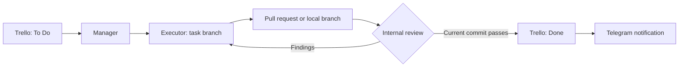

<div align="center">

<h1>Codex Orchestrator</h1>

<p><strong>Trello tasks. Isolated Codex agents. Reviewed changes.</strong></p>

<p>A self-hosted workspace for turning a task queue into GitHub pull requests or locally reviewed Git branches.</p>

<p>
  
  
  
</p>

<p>
  <a href="#getting-started">Getting started</a> &nbsp;·&nbsp;
  <a href="#how-it-works">How it works</a> &nbsp;·&nbsp;
  <a href="#isolation-and-permissions">Isolation</a> &nbsp;·&nbsp;
  <a href="docs/DASHBOARD.md">Dashboard guide</a> &nbsp;·&nbsp;
  <a href="docs/ru/README.md">Русский</a>
</p>

</div>

---

Keep your tasks in Trello, let Codex work in separate branches, and follow progress from a local dashboard or Telegram. Executors implement changes, reviewers check the current commit, and the controller handles publication through a restricted Git broker.

Use an existing GitHub repository, start a new project, or work entirely with local Git branches and review records. The system is independent of any particular repository, base branch, or GitHub account.

> **You keep the merge decision.** An internal review can mark a task Done, but agents cannot submit GitHub Approve reviews, merge pull requests, force-push, or publish to the base branch. These operations are excluded from the system's capabilities.

## What you get

| Capability | What it does |
| --- | --- |
| **Trello-driven work** | Checks To Do hourly and again when a task reaches Done. A clear card title can be the entire specification. |
| **Parallel executors** | Runs up to two executors, each with its own task branch and workspace. |
| **Review and automatic fixes** | Reviews the exact commit, returns findings to the executor, and repeats within a configurable fix limit. |
| **Operator dashboard** | Shows task states, blockers, agent activity, filtered logs, configuration, and manual controls. |
| **Telegram conversations** | Routes replies to the agent that asked the question and sends completion messages after internal review passes. |
| **Multiple environments** | Adds, views, edits, switches, and removes saved project setups, with a GitHub account selected for each project. |
| **Local Git mode** | Saves task branches and review records without requiring GitHub or creating pull requests. |
| **Task references** | Supplies linked images, attached files, and other project branches as local, read-only context. |
| **Recovery controls** | Retries interrupted or timed-out agent runs within limits, retaining workspaces and known sessions. |
| **Two execution backends** | Uses isolated Docker containers or a restricted native Windows environment. |

## How it works



The controller moves selected cards to **In Progress** while the executors work. Creating a PR does not complete the task: **Done requires an internal review with no findings on the current commit**.

Findings return to the original executor's session and branch. Automatic fixes run for three rounds by default; continuing beyond the limit requires a human reply. Questions about genuine ambiguities or missing resources are sent immediately, while routine implementation choices remain autonomous.

A new, unreviewed revision returns an open task to In Progress. Move a card to **Merged**, archive it, or put it in any list outside To Do / In Progress / Done to take it out of the managed workflow. Later PR updates do not reopen those completed cards. People merge changes and archive cards themselves. To request further work on an open PR, explicitly return its card to a managed list and reply to its **Review complete** notification.

## Getting started

### 1. Prepare the prerequisites

| Requirement | Used for |
| --- | --- |
| **Go 1.26+ and Git** | Building the controller and managing project history. |
| **Codex CLI with a ChatGPT login** | Running agents. API-key authentication is not accepted by this project. |
| **Trello API key and token** | Reading cards and moving them between the configured lists. |
| **Telegram bot token and private chat ID** | Questions, replies, and notifications. |
| **GitHub CLI** | GitHub mode only; sign in to an account with access to the selected repository. |
| **An execution backend** | Docker with Linux containers, or Windows with an elevated Codex sandbox. |

Clone the project:

```powershell
git clone https://github.com/UGamerZ/codex-orchestrator.git
cd codex-orchestrator
```

### 2. Choose an installation path

| Backend | Platform | Setup guide |
| --- | --- | --- |
| **Docker** | Linux, or Windows using Linux Docker Engine through WSL2 | [Docker setup below](#docker-setup) |
| **Restricted native execution** | Windows, without Docker or a VM | [Native Windows installation](NATIVE-INSTALL.md) |

The PowerShell project wizard lets you choose the repository or local project, base branch, GitHub account, and Trello routing. It can offer to create a GitHub repository for a new local project. Configuration does not start agents.

<details>
<summary><strong>Native Windows setup</strong></summary>

Run these commands from an Administrator PowerShell:

```powershell
.\scripts\Configure-Project.ps1 -Backend native-windows -Config config.native.json
.\scripts\Setup-Native.ps1 -Config config.native.json
```

Configure integrations and Codex authentication as described below, then validate and start:

```powershell
.\scripts\Start-Orchestrator.ps1 -Config config.native.json -Check
.\scripts\Start-Orchestrator.ps1 -Config config.native.json
```

Setup provisions the restricted backend and runs isolation probes. Read the [native installation guide](NATIVE-INSTALL.md) for prerequisites, storage locations, and limitations.

</details>

<a name="docker-setup"></a>

<details>
<summary><strong>Docker setup</strong></summary>

On Windows, prepare Ubuntu WSL2 and Linux Docker Engine first. The supplied setup uses Docker Engine inside WSL2; it does not depend on Docker Desktop. See the [Docker installation notes](#docker-installation-notes).

```powershell
.\scripts\Configure-Project.ps1 -Backend docker -Config config.json
.\scripts\Setup.ps1 -Config config.json
```

Configure integrations and Codex authentication as described below, verify isolation, then validate and start:

```powershell
.\scripts\Start-Orchestrator.ps1 -Config config.json -Check
.\scripts\Start-Orchestrator.ps1 -Config config.json
```

Run `scripts/check-isolation.sh` in the Linux environment before processing tasks. Setup builds the images, proxy, and internal network. Reapply `scripts/network-policy.sh` after restarting Docker.

</details>

### 3. Configure access

Create `secrets/integrations.json` from [secrets.example.json](secrets.example.json) and fill in the Trello and Telegram credentials. Set the board ID, three distinct list IDs, and Telegram chat ID in your local configuration.

For GitHub mode, authenticate the **project account** through GitHub CLI. The controller selects the configured account explicitly; the account that owns this orchestrator repository does not determine your working identity. Local mode requires no GitHub account.

Set `codex_auth_file` to your chosen Codex ChatGPT authentication file. For a long-running native installation, use the host's maintained login rather than a one-time copy that can expire. The native controller synchronizes authentication before each run and preserves a newer private runtime login for the same account. Authentication files remain inaccessible to native agent tools.

Use a dedicated Telegram bot: the controller polls updates, so another poller or webhook must not consume the same bot messages.

Keep secrets and runtime configuration private. Do not send credentials through Telegram or put them in task descriptions.

### 4. Open the dashboard

Open **http://127.0.0.1:8787** on the controller machine.

- **Tasks:** inspect progress, answer questions, retry blocked work, and request a board check.
- **Agents:** follow tool activity, results, and errors in filtered logs. Private reasoning is excluded.
- **Environments:** manage projects and GitHub accounts; switch when workers are idle.
- **Configuration:** adjust models, limits, deadlines, and scheduling.
- **Events:** inspect controller actions, failures, and recovery.

Verify a complete cycle with a test card before configuring unattended operation: task selection, implementation, review, any clarification reply, and the completion notification.

See the [dashboard and watchdog guide](docs/DASHBOARD.md) for operation and startup monitoring.

## Daily use

| Action | Where |
| --- | --- |
| Add work | Put a card in the configured **To Do** list. |
| Check the board now | Send `/check` in Telegram or use the dashboard. |
| Check task states | Send `/status` or open **Tasks**. |
| Answer an agent | Use **Reply** on its Telegram question, or answer in the dashboard. |
| Request changes after review | Reply to the **Review complete** notification for an open system-owned task. |
| Change projects | Use **Environments → Switch environment** after active workers finish. |
| Remove a saved environment | Use **Delete environment** on an inactive profile. Files and task history are retained. |

Environments keep their own tasks, workspaces, branches, logs, and sessions. They may share a Trello board and lists; only the selected environment processes work. Editing project identity or routing retains the previous setup as a separate environment.

Questions and answers stay attached to their originating tasks, including inactive environments. Deleting an environment prevents old Telegram replies from restarting its agents.

### Models and limits

Defaults shipped in the example configurations:

| Role or limit | Default |
| --- | --- |
| Executor | `gpt-6.1-sol`, `low` effort |
| Executor fallback | `gpt-6-sol`, `medium` effort |
| Manager and reviewer | `gpt-6-luna`, `low` effort |
| Concurrent executors | 2 |
| Board check interval | 1 hour |
| Automatic fix rounds | 3 |
| General run deadline | 45 minutes |
| Reviewer deadline | 15 minutes, capped by the general deadline |

Models and reasoning levels are configurable; choose models available to your Codex account. The fallback is used when the primary model is explicitly unavailable. It does not bypass subscription limits: a rate limit delays the next attempt by an hour.

Interrupted or timed-out agent runs can retry up to three times, five minutes apart. Human questions, exhausted fix limits, publication uncertainty, and permission blocks remain blockers. A quiet agent is not considered stuck solely because it has not sent a recent message.

## Isolation and permissions

The trusted controller manages integrations and publication. Executors work on task branches; reviewers and managers receive read-only working copies.

| Boundary | Enforcement |
| --- | --- |
| **Git publication** | A separate broker ignores the agent's Git metadata and permits ordinary pushes only to the task's `codex/...` branch. |
| **GitHub review** | Agents have no GitHub credentials. Approve and merge operations are not exposed. |
| **Integration credentials** | Trello, Telegram, and GitHub management credentials remain outside agent environments. |
| **Data preservation** | A conservative publisher guard blocks newly added destructive SQL operations. Migrating settings does not imply permission to delete the source data. |
| **Workflow changes** | Changes to `.github/workflows` require explicit, task-specific human permission, checked by the publisher. |
| **Manual branch updates** | Automatic continuation requires `auto_continue_task_branches`; other PR branches remain read-only. |
| **Agent capabilities** | Apps, plugins, hooks, browser tools, and built-in delegation are disabled. |
| **Isolation failures** | A failed sandbox run does not trigger an unrestricted retry. |

<details>
<summary><strong>Docker isolation details</strong></summary>

Each task uses named volumes for its workspace, private publication repository, review materials, and role-specific Codex state. The host project directory and Docker socket are not mounted into agent containers.

Agents run as UID 1000 with dropped capabilities, `no-new-privileges`, a read-only root filesystem, and CPU, memory, and process limits. Manager and reviewer workspaces are read-only.

The internal network allows outbound model traffic only through a CONNECT proxy restricted to `chatgpt.com:443`, `api.openai.com:443`, and `auth.openai.com:443`. Private destinations, neighboring agents, host services, and external DNS are blocked by the network policy. Prepare required dependencies in the image; missing resources require human assistance.

Codex uses `danger-full-access` only inside these containers: Docker, mounts, and network policy provide that boundary. Docker agents can access their selected ChatGPT credentials for model access, but not integration credentials. Native execution does not use that mode.

Containers share the Linux kernel; they do not provide the same boundary as a separate virtual machine. Isolation probes and the static SQL guard are safeguards, not a complete security proof.

</details>

<details>
<summary><strong>Task attachments and branch references</strong></summary>

The controller downloads Trello attachments and supported public HTTPS links from card descriptions and answers. Agents receive local files and a manifest; download credentials stay on the host. Private-network destinations and credential forwarding are rejected. Other private services require separately supplied files.

Limits are **32 files**, **16 MiB per file**, and **64 MiB per task**. Failed downloads are listed so the agent can ask for the specific missing resource.

Agents also receive a read-only `branches.git` reference repository with the project's branches and history, plus `branches.txt` containing commit IDs. The reference has no remote or credentials and is excluded from publication. Its limit is **512 MiB**.

Context is mounted at `/review-input/context` in Docker and stored under `.orchestrator-review/context` in the native task workspace.

</details>

<details>
<summary><strong>Human permissions and publication rules</strong></summary>

For a workflow change, reply directly to the executor's question beginning **May I add or modify a file in .github/workflows**. A saved affirmative reply, such as `yes` or `go ahead`, authorizes that task's workflow edits only. It does not grant base-branch writes, force pushes, GitHub approval, merging, or access to secrets.

The SQL guard blocks newly added `DELETE FROM`, `TRUNCATE`, `DROP TABLE/DATABASE/SCHEMA`, and `ALTER TABLE DROP` operations before publication. It has no Telegram-reply bypass; flagged operations require removal or manual inspection. Tests must use disposable, isolated databases.

Existing tracked relative symlinks are preserved only when their complete target chain stays inside the working copy and avoids Git metadata. New or modified links and submodules require separate human preparation.

Open external PRs targeting the configured base branch may receive review comments, but automatic fixes apply only to system-created task branches. Enabling `auto_continue_task_branches` permits those task branches to continue after verified manual updates. The exact-head guard still stops publication if the branch changes during preparation or push.

</details>

## Documentation

| Guide | Contents |
| --- | --- |
| [Project setup](PROJECT-SETUP.md) | Existing GitHub repositories, new projects, account selection, and local-only work. |
| [Native Windows installation](NATIVE-INSTALL.md) | Restricted execution without Docker or a VM, isolation probes, and authentication. |
| [Dashboard and operations](docs/DASHBOARD.md) | Task controls, agent logs, environments, Telegram, and the watchdog. |
| [Docker configuration example](config.example.json) | Starting configuration for Docker. |
| [Native configuration example](config.native.example.json) | Starting configuration for restricted Windows execution. |
| [Integration secrets example](secrets.example.json) | Local Trello and Telegram credential fields. |
| [Russian documentation](docs/ru/README.md) | Russian-language overview and setup guides. |

English is the base language for documentation and operator messages. Tasks and project content may use other languages; agents can follow a task's requested language.

<a name="docker-installation-notes"></a>

<details>
<summary><strong>Docker installation notes</strong></summary>

**Windows / WSL2**

1. If Windows runs inside a VM, enable nested virtualization on its host.
2. Install Ubuntu WSL2 with `wsl --install --distribution Ubuntu-24.04 --no-launch`.
3. Start Ubuntu and run `scripts/install-docker-ubuntu.sh` as root to install Docker Engine from its official APT repository.
4. Follow [Docker setup](#docker-setup), configure integrations, and verify isolation before processing tasks.

Use the WSL Linux Docker Engine path on Windows Server; Docker Desktop is not supported there. With WSL, named volumes live on the Docker/WSL virtual disk. Moving them to a different physical disk requires moving the Docker data root or WSL disk separately.

**Linux**

Set `docker_distro` to an empty string, authenticate the configured GitHub account if needed, and build the controller:

```sh
go build -o bin/orchestrator ./cmd/orchestrator
```

Build the worker image and Compose proxy, apply `scripts/network-policy.sh`, and run `scripts/check-isolation.sh`. Supply the integration environment variables to the controller before starting it. The interactive setup wizard and launch script use PowerShell; Linux deployments require manual service configuration.

</details>

## Development

```sh
go test ./...
go vet ./...
```

The checks cover task routing, concurrency, review restrictions, publication, recovery, project separation, and network policy. They complement isolation probes and real integration checks.

Runtime state, local configurations, credentials, and binaries are excluded from Git. Preserve the environment registry and state directories in your private backups; task data and working volumes are retained for recovery.

For background: [Codex non-interactive mode](https://learn.chatgpt.com/docs/non-interactive-mode), [Codex authentication](https://learn.chatgpt.com/docs/auth), and [Docker Engine on Ubuntu](https://docs.docker.com/engine/install/ubuntu/).
