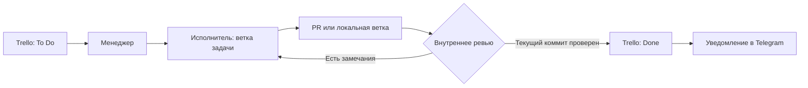

<div align="center">

<h1>Codex Orchestrator</h1>

<p><strong>Задачи в Trello. Изолированные агенты Codex. Проверенные изменения.</strong></p>

<p>Среда на вашем сервере, которая превращает очередь задач в GitHub pull requests или локальные Git-ветки с результатами ревью.</p>

<p>
  
  
  
</p>

<p>
  <a href="#быстрый-старт">Быстрый старт</a> &nbsp;·&nbsp;
  <a href="#как-это-работает">Как это работает</a> &nbsp;·&nbsp;
  <a href="#изоляция-и-разрешения">Изоляция</a> &nbsp;·&nbsp;
  <a href="../DASHBOARD.md">Руководство по панели (EN)</a> &nbsp;·&nbsp;
  <a href="#поддержать-проект">Поддержать проект</a> &nbsp;·&nbsp;
  <a href="../../README.md">English</a>
</p>

</div>

---

Ведите задачи в Trello, поручайте работу Codex в отдельных ветках и следите за ходом выполнения в локальной веб-панели или Telegram. Исполнители вносят изменения, ревьюеры проверяют текущий коммит, а контроллер публикует результат через Git-сервис с ограниченными полномочиями.

Подключите существующий GitHub-репозиторий, начните новый проект или работайте только с локальными Git-ветками и результатами ревью. Система не привязана к определённому репозиторию, базовой ветке или аккаунту GitHub.

> **Решение о слиянии остаётся за вами.** Внутреннее ревью может перевести задачу в Done, но агенты не могут отправлять GitHub Approve, сливать PR, выполнять force push или публиковать изменения в базовую ветку. Эти операции не входят в программные возможности системы.

## Возможности

| Возможность | Что делает |
| --- | --- |
| **Задачи из Trello** | Проверяет To Do раз в час и после перехода задачи в Done. Понятного заголовка карточки может быть достаточно для полного условия. |
| **Параллельные исполнители** | Запускает до двух исполнителей, каждому выделяет ветку задачи и рабочую копию. |
| **Ревью и автоматические исправления** | Проверяет конкретный коммит, возвращает замечания исполнителю и повторяет цикл в пределах заданного лимита. |
| **Веб-панель управления** | Показывает состояния задач, причины остановки, активность агентов, отфильтрованные логи, настройки и ручные действия. |
| **Общение через Telegram** | Передаёт ответ агенту, который задал вопрос, и уведомляет о завершении после успешного внутреннего ревью. |
| **Несколько окружений** | Позволяет добавлять, просматривать, редактировать, переключать и удалять настройки проектов, выбирая аккаунт GitHub для каждого. |
| **Локальный Git-режим** | Сохраняет ветки задач и результаты ревью без GitHub и создания PR. |
| **Материалы к задачам** | Предоставляет изображения по ссылкам, вложенные файлы и другие ветки проекта локально, только для чтения. |
| **Восстановление работы** | Повторяет прерванные и превысившие срок запуски в пределах лимитов, сохраняя рабочие копии и известные сессии. |
| **Два варианта выполнения** | Использует изолированные Docker-контейнеры или ограниченную среду Windows без Docker. |

## Как это работает



Контроллер переводит выбранные карточки в **In Progress**, пока исполнители работают. Создание PR не завершает задачу: **для перехода в Done нужно внутреннее ревью текущего коммита без замечаний**.

Замечания возвращаются в исходную сессию и ветку исполнителя. По умолчанию доступны три раунда автоматических исправлений; для продолжения сверх лимита нужен ответ человека. Вопросы о существенной неоднозначности или недостающих ресурсах отправляются сразу, а обычные решения по реализации агент принимает самостоятельно.

Новая непроверенная версия возвращает открытую задачу в In Progress. Перенесите карточку в **Merged**, архивируйте её или переместите в любой список вне To Do / In Progress / Done, чтобы исключить её из управляемого процесса. Последующие изменения PR не возобновляют такие завершённые задачи. Слияние изменений и архивирование карточек выполняют люди. Чтобы запросить доработку открытого PR, верните карточку в управляемый список и ответьте на её уведомление **Review complete**.

## Быстрый старт

### 1. Подготовьте необходимые инструменты и доступы

| Требование | Для чего нужно |
| --- | --- |
| **Go 1.26+ и Git** | Сборка контроллера и работа с историей проекта. |
| **Codex CLI с авторизацией ChatGPT** | Запуск агентов. Этот проект не поддерживает авторизацию по API-ключу. |
| **API key и token Trello** | Чтение карточек и перемещение между настроенными списками. |
| **Токен Telegram-бота и ID личного чата** | Вопросы, ответы и уведомления. |
| **GitHub CLI** | Только для GitHub-режима; нужен вход в аккаунт с доступом к выбранному репозиторию. |
| **Среда выполнения** | Docker с Linux-контейнерами либо Windows с песочницей Codex в режиме elevated. |

Клонируйте проект:

```powershell
git clone https://github.com/UGamerZ/codex-orchestrator.git
cd codex-orchestrator
```

### 2. Выберите вариант установки

| Вариант | Платформа | Инструкция |
| --- | --- | --- |
| **Docker** | Linux либо Windows с Linux Docker Engine через WSL2 | [Установка Docker ниже](#docker-setup) |
| **Ограниченная среда Windows** | Windows без Docker и виртуальной машины | [Установка на Windows](NATIVE-INSTALL.md) |

Мастер настройки на PowerShell позволяет выбрать репозиторий или локальный проект, базовую ветку, аккаунт GitHub и списки Trello. Для нового локального проекта он может предложить создание GitHub-репозитория. Настройка сама по себе не запускает агентов.

<details>
<summary><strong>Установка на Windows без Docker</strong></summary>

Выполните команды в PowerShell от имени администратора:

```powershell
.\scripts\Configure-Project.ps1 -Backend native-windows -Config config.native.json
.\scripts\Setup-Native.ps1 -Config config.native.json
```

Настройте интеграции и авторизацию Codex, как описано ниже, затем выполните проверку и запуск:

```powershell
.\scripts\Start-Orchestrator.ps1 -Config config.native.json -Check
.\scripts\Start-Orchestrator.ps1 -Config config.native.json
```

Установщик подготавливает ограниченную среду и проверяет изоляцию. Требования, расположение рабочих данных и ограничения описаны в [инструкции по установке на Windows](NATIVE-INSTALL.md).

</details>

<a name="docker-setup"></a>

<details>
<summary><strong>Установка Docker</strong></summary>

На Windows сначала подготовьте Ubuntu WSL2 и Linux Docker Engine. Скрипты используют Docker Engine внутри WSL2 и не зависят от Docker Desktop. Подробнее — в [примечаниях по установке Docker](#docker-installation-notes).

```powershell
.\scripts\Configure-Project.ps1 -Backend docker -Config config.json
.\scripts\Setup.ps1 -Config config.json
```

Настройте интеграции и авторизацию Codex, как описано ниже, проверьте изоляцию, затем выполните проверку конфигурации и запуск:

```powershell
.\scripts\Start-Orchestrator.ps1 -Config config.json -Check
.\scripts\Start-Orchestrator.ps1 -Config config.json
```

До обработки задач выполните `scripts/check-isolation.sh` в Linux-среде. Установщик собирает образы, прокси и внутреннюю сеть. После перезапуска Docker повторно примените `scripts/network-policy.sh`.

</details>

### 3. Настройте доступы

Создайте `secrets/integrations.json` по образцу [secrets.example.json](../../secrets.example.json) и укажите данные Trello и Telegram. В локальной конфигурации задайте ID доски, ID трёх разных списков и ID чата Telegram.

Для GitHub-режима войдите через GitHub CLI в **аккаунт проекта**. Контроллер явно выбирает настроенный аккаунт; владелец репозитория оркестратора не определяет рабочую учётную запись. В локальном режиме аккаунт GitHub не нужен.

Укажите в `codex_auth_file` путь к выбранному файлу авторизации Codex через ChatGPT. Для постоянно работающей среды Windows используйте обновляемую авторизацию на хосте, а не разовую копию, срок которой может истечь. Контроллер Windows синхронизирует авторизацию перед каждым запуском и сохраняет более свежую внутреннюю сессию того же аккаунта. Файлы авторизации недоступны инструментам агентов в Windows.

Используйте отдельного Telegram-бота: контроллер получает обновления опросом, поэтому другой обработчик или webhook не должен забирать сообщения этого бота.

Храните секреты и рабочую конфигурацию приватно. Не отправляйте учётные данные в Telegram и не добавляйте их в описания задач.

### 4. Откройте веб-панель

Откройте **http://127.0.0.1:8787** на машине с контроллером.

- **Tasks:** следите за задачами, отвечайте на вопросы, повторяйте заблокированные запуски и запрашивайте проверку доски.
- **Agents:** просматривайте действия инструментов, результаты и ошибки в отфильтрованных логах. Приватные рассуждения не отображаются.
- **Environments:** управляйте проектами и аккаунтами GitHub; переключайтесь после завершения активных агентов.
- **Configuration:** настраивайте модели, лимиты, сроки выполнения и расписание.
- **Events:** просматривайте действия контроллера, ошибки и восстановление.

Перед настройкой работы без присмотра проверьте полный цикл на тестовой карточке: выбор задачи, реализацию, ревью, ответ на уточнение при необходимости и уведомление о завершении.

Работа панели и контроль запуска описаны в [руководстве по панели и watchdog (EN)](../DASHBOARD.md).

## Работа с системой

| Действие | Как выполнить |
| --- | --- |
| Добавить задачу | Поместите карточку в настроенный список **To Do**. |
| Проверить доску сейчас | Отправьте `/check` в Telegram или воспользуйтесь панелью. |
| Посмотреть состояния задач | Отправьте `/status` или откройте **Tasks**. |
| Ответить агенту | Используйте **Reply** на его вопрос в Telegram или ответьте через панель. |
| Запросить изменения после ревью | Ответьте на уведомление **Review complete** для открытой задачи, созданной системой. |
| Сменить проект | Выберите **Environments → Switch environment**, когда активные агенты завершат работу. |
| Удалить сохранённое окружение | Нажмите **Delete environment** у неактивного профиля. Файлы и история задач сохраняются. |

У окружений раздельные задачи, рабочие копии, ветки, логи и сессии. Они могут использовать одну доску и списки Trello; работу выполняет только выбранное окружение. При изменении проекта или маршрутизации задач прежняя настройка сохраняется как отдельное окружение.

Вопросы и ответы остаются привязаны к исходным задачам, в том числе в неактивных окружениях. После удаления окружения старые ответы в Telegram не могут перезапустить его агентов.

### Модели и лимиты

Значения по умолчанию из примеров конфигурации:

| Роль или ограничение | Значение |
| --- | --- |
| Исполнитель | `gpt-6.1-sol`, уровень `low` |
| Резервная модель исполнителя | `gpt-6-sol`, уровень `medium` |
| Менеджер и ревьюер | `gpt-6-luna`, уровень `low` |
| Одновременные исполнители | 2 |
| Интервал проверки доски | 1 час |
| Раунды автоматических исправлений | 3 |
| Общий срок одного запуска | 45 минут |
| Срок ревью | 15 минут, не больше общего срока запуска |

Модели и уровни рассуждений настраиваются; выбирайте модели, доступные вашему аккаунту Codex. Резервная модель используется при явной недоступности основной. Она не обходит лимиты подписки: при ограничении частоты следующий запуск откладывается на час.

Прерванные или превысившие срок запуски могут повторяться до трёх раз с интервалом пять минут. Вопросы человеку, исчерпанный лимит исправлений, неопределённый результат публикации и ограничения разрешений остаются блокирующими условиями. Отсутствие недавних сообщений само по себе не означает, что агент завис.

## Изоляция и разрешения

Доверенный контроллер управляет интеграциями и публикацией. Исполнители работают в ветках задач; ревьюеры и менеджеры получают рабочие копии только для чтения.

Каждая новая задача начинает работу с чистого снимка настроенной базовой ветки в собственной рабочей копии. В Windows у каждой задачи и роли также отдельный CODEX_HOME: история диалогов, базы состояния, память, кэши и временные файлы не переиспользуются между задачами. Исправления по ревью и повторные запуски сохраняют только работу этой же задачи. Docker использует новые контейнеры и отдельные тома задач. В обоих режимах сохраняется настроенный параллелизм: до двух исполнителей одновременно. Разные рабочие каталоги Windows не являются границей безопасности между агентами на уровне ОС. В Windows задачи разделяют ОС хоста и установленные инструменты; отдельные экземпляры баз данных или сервисов нужно подготовить дополнительно.

| Область | Как ограничена |
| --- | --- |
| **Публикация в Git** | Отдельный Git-сервис игнорирует метаданные Git агента и допускает обычный push только в ветку задачи `codex/...`. |
| **Ревью в GitHub** | У агентов нет учётных данных GitHub. Операции Approve и merge не предоставляются. |
| **Секреты интеграций** | Учётные данные управления Trello, Telegram и GitHub остаются за пределами среды агентов. |
| **Сохранность данных** | Консервативная проверка публикации блокирует новые разрушительные SQL-операции. Перенос настроек не означает разрешения удалить исходные данные. |
| **Изменения workflow** | Изменения `.github/workflows` требуют явного разрешения человека для конкретной задачи; его проверяет сервис публикации. |
| **Ручные изменения веток** | Автоматическое продолжение требует `auto_continue_task_branches`; остальные ветки PR доступны только для чтения. |
| **Возможности агентов** | Apps, плагины, hooks, браузерные инструменты и встроенное делегирование отключены. |
| **Сбои изоляции** | Неудачный запуск в песочнице не приводит к повтору без ограничений. |

<details>
<summary><strong>Как устроена изоляция Docker</strong></summary>

Каждая задача использует именованные тома для рабочей копии, закрытого репозитория публикации, материалов ревью и состояния Codex для каждой роли. Каталог проекта на хосте и Docker socket не монтируются в контейнеры агентов.

Агенты работают с UID 1000, без дополнительных capabilities, с `no-new-privileges`, корневой файловой системой только для чтения и лимитами CPU, памяти и процессов. Рабочие копии менеджера и ревьюера доступны только для чтения.

Внутренняя сеть допускает исходящие запросы к модели только через CONNECT-прокси со списком `chatgpt.com:443`, `api.openai.com:443` и `auth.openai.com:443`. Сетевая политика блокирует частные адреса, соседних агентов, службы хоста и внешний DNS. Нужные зависимости следует заранее включить в образ; при нехватке ресурсов потребуется помощь человека.

Codex использует `danger-full-access` только внутри этих контейнеров: границу обеспечивают Docker, монтирования и сетевая политика. Docker-агенты имеют доступ к выбранным учётным данным ChatGPT для обращения к модели, но не к секретам интеграций. В среде Windows без Docker этот режим не используется.

Контейнеры разделяют ядро Linux и не обеспечивают такую же границу, как отдельная виртуальная машина. Проверки изоляции и статическая проверка SQL снижают риск, но не являются полным доказательством безопасности.

</details>

<details>
<summary><strong>Вложения и другие ветки проекта</strong></summary>

Контроллер скачивает вложения Trello и поддерживаемые публичные HTTPS-ссылки из описаний карточек и ответов. Агенты получают локальные файлы и манифест; данные авторизации для скачивания остаются на хосте. Частные сетевые адреса и пересылка учётных данных запрещены. Файлы из других приватных сервисов нужно предоставить отдельно.

Лимиты: **32 файла**, **16 МиБ на файл** и **64 МиБ на задачу**. Неудачные загрузки перечисляются в манифесте, чтобы агент мог запросить конкретный недостающий материал.

Также агентам предоставляется `branches.git` только для чтения с ветками проекта и их историей, а также `branches.txt` с ID коммитов. У справочного репозитория нет remote или учётных данных; в публикацию он не попадает. Его лимит — **512 МиБ**.

В Docker материалы монтируются в `/review-input/context`, а в среде Windows находятся в `.orchestrator-review/context` внутри рабочей копии задачи.

</details>

<details>
<summary><strong>Разрешения человека и правила публикации</strong></summary>

Для изменения workflow ответьте непосредственно на вопрос исполнителя, начинающийся с **May I add or modify a file in .github/workflows**. Сохранённый положительный ответ, например `yes` или `go ahead`, разрешает изменение workflow только в этой задаче. Он не даёт права менять базовую ветку, выполнять force push, отправлять GitHub Approve, сливать изменения или получать секреты.

Проверка SQL блокирует новые операции `DELETE FROM`, `TRUNCATE`, `DROP TABLE/DATABASE/SCHEMA` и `ALTER TABLE DROP` до публикации. Обойти её ответом в Telegram нельзя: обнаруженные операции нужно убрать или проверить вручную. Тесты должны использовать одноразовые изолированные базы данных.

Существующие отслеживаемые относительные символические ссылки сохраняются, только если вся цепочка целей остаётся внутри рабочей копии и не затрагивает метаданные Git. Новые или изменённые ссылки и подмодули требуют отдельной подготовки человеком.

Система может комментировать открытые внешние PR в настроенную базовую ветку, но автоматически исправляет только созданные ею ветки задач. Параметр `auto_continue_task_branches` разрешает продолжение таких задач после проверенных ручных изменений. Проверка точного коммита по-прежнему останавливает публикацию, если ветка изменилась во время подготовки или push.

</details>

## Документация

| Руководство | Содержание |
| --- | --- |
| [Настройка проекта](PROJECT-SETUP.md) | Существующие GitHub-репозитории, новые проекты, выбор аккаунта и локальная работа. |
| [Установка на Windows без Docker](NATIVE-INSTALL.md) | Ограниченное выполнение без Docker и VM, проверки изоляции и авторизация. |
| [Панель и эксплуатация (EN)](../DASHBOARD.md) | Управление задачами, логи агентов, окружения, Telegram и watchdog. |
| [Пример конфигурации Docker](../../config.example.json) | Начальная конфигурация для Docker. |
| [Пример конфигурации Windows](../../config.native.example.json) | Начальная конфигурация для ограниченного выполнения в Windows. |
| [Пример секретов интеграций](../../secrets.example.json) | Поля учётных данных Trello и Telegram для локального хранения. |
| [Основная документация на английском](../../README.md) | Англоязычное описание проекта и ссылки на руководства. |

Основной язык документации и сообщений системы — английский. Задачи и содержимое проектов могут быть на других языках; агенты могут следовать языку, указанному в задаче.

<a name="docker-installation-notes"></a>

<details>
<summary><strong>Примечания по установке Docker</strong></summary>

**Windows / WSL2**

1. Если Windows работает в виртуальной машине, включите вложенную виртуализацию на её хосте.
2. Установите Ubuntu WSL2 командой `wsl --install --distribution Ubuntu-24.04 --no-launch`.
3. Запустите Ubuntu и выполните `scripts/install-docker-ubuntu.sh` от root, чтобы установить Docker Engine из официального APT-репозитория.
4. Следуйте разделу [установки Docker](#docker-setup), настройте интеграции и проверьте изоляцию до обработки задач.

На Windows Server используйте Linux Docker Engine внутри WSL2; Docker Desktop на этой платформе не поддерживается. При использовании WSL именованные тома находятся на виртуальном диске Docker/WSL. Для переноса на другой физический диск нужно отдельно перенести Docker data root или диск WSL.

**Linux**

Установите `docker_distro` в пустую строку, при необходимости авторизуйте настроенный аккаунт GitHub и соберите контроллер:

```sh
go build -o bin/orchestrator ./cmd/orchestrator
```

Соберите образ исполнителя и Compose-прокси, примените `scripts/network-policy.sh` и выполните `scripts/check-isolation.sh`. Перед запуском контроллера задайте переменные окружения интеграций. Интерактивный мастер и скрипт запуска используют PowerShell; для Linux требуется ручная настройка службы.

</details>

## Разработка

```sh
go test ./...
go vet ./...
```

Проверки охватывают маршрутизацию задач, параллельное выполнение, ограничения ревью, публикацию, восстановление, разделение проектов и сетевую политику. Они дополняют проверки изоляции и работу с реальными интеграциями.

Рабочие состояния, локальные конфигурации, учётные данные и бинарники исключены из Git. Сохраняйте реестр окружений и каталоги состояния в приватных резервных копиях; данные задач и рабочие тома сохраняются для восстановления.

Дополнительные материалы: [неинтерактивный режим Codex](https://learn.chatgpt.com/docs/non-interactive-mode), [авторизация Codex](https://learn.chatgpt.com/docs/auth) и [Docker Engine в Ubuntu](https://docs.docker.com/engine/install/ubuntu/).

## Поддержать проект

Если проект вам полезен, вы можете поддержать его разработку:

- [Patreon](https://www.patreon.com/vladlazutchenko)
- [DonationAlerts](https://www.donationalerts.com/r/vladislavlazutchenko)
